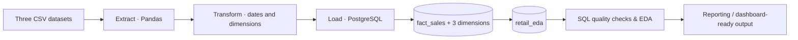

# Retail Sales ETL & Business Insights

**From raw retail records to a clearer picture of store performance, shopping patterns, and economic context.**

**Tech stack:** Python · Pandas · PostgreSQL · SQLAlchemy · SQL

## Why this project matters

A store can report strong sales and still leave important questions unanswered. Is the performance consistent throughout the year? Is it concentrated in a handful of departments? Do holiday weeks look different from regular weeks? And how should external conditions—such as fuel prices or unemployment—be considered when interpreting the numbers?

This project explores those questions by building a reproducible **Extract, Transform, Load (ETL) pipeline** and using SQL to analyze weekly retail sales. The aim is not simply to move CSV files into a database. It is to turn disconnected records into a dataset that makes business comparisons easier to investigate, explain, and eventually visualize.

## At a glance

The exported `retail_eda` dataset used for this analysis contains:

| Measure | Dataset snapshot |
| --- | ---: |
| Sales observations | **170,640** |
| Stores | **18** |
| Departments | **80** |
| Distinct weekly dates | **143** |
| Date range | **5 Feb 2010 – 26 Oct 2012** |
| Total recorded sales | **2,939,547,602.88** |
| Missing values in the exported analytical columns | **0** |
| Duplicate Store–Department–Date combinations | **0** |

*Sales amounts are shown in the units of the source data; the currency is not specified in the exported file. This is the supplied snapshot, not a claim about every store in a wider retail network.*

## Business questions

The analysis is organized around four questions:

1. **Sales performance:** How do sales vary over time, and which stores and departments contribute the most?
2. **Store differences:** How do store types and store sizes relate to observed sales performance?
3. **Holiday patterns:** Are average weekly sales different during holiday and non-holiday periods?
4. **Economic context:** How do temperature, fuel prices, CPI, and unemployment move alongside retail sales?

Together, these questions connect the data pipeline to a practical business goal: understanding *where performance comes from* and *which comparisons need more context* before drawing conclusions.

## How the data moves



### Source datasets

| File | What it contributes |
| --- | --- |
| `Data/sales_dataset.csv` | Weekly sales by store and department, dates, and holiday indicators |
| `Data/Stores_dataset.csv` | Store category and store size |
| `Data/Features_dataset.csv` | Temperature, fuel prices, CPI, unemployment, and other original features |

### The ETL pipeline

- **Extract — `ETL/extract.py`:** Reads the three CSV files into Pandas DataFrames and prints initial samples and data types.
- **Transform — `ETL/transform.py`:** Parses the source-specific date formats, removes `MarkDown1`–`MarkDown5` from the feature dataset, normalizes column names, and prepares one fact table and three dimensions.
- **Load — `ETL/load.py`:** Writes those four tables to PostgreSQL through SQLAlchemy. Connection credentials are read from a local `.env` file, not hard-coded in the Python source.
- **Orchestration — `main.py`:** Executes the steps in order so the ingestion process can be reproduced with one command.

### Analytical data model

| PostgreSQL table | Purpose | Main fields |
| --- | --- | --- |
| `fact_sales` | Weekly store–department sales observations | `store`, `dept`, `date`, `weekly_sales`, `isholiday` |
| `dim_store` | Store attributes | `store`, `type`, `size` |
| `dim_feature` | Store-level conditions by date | `store`, `date`, `temperature`, `fuel_price`, `cpi`, `unemployment` |
| `dim_date` | Reporting calendar | `date`, `year`, `month`, `week` |

The SQL script joins these tables into **`retail_eda`**, a physical analysis table. Store attributes are matched by `store`; economic features are matched by **both `store` and `date`**; and calendar attributes are matched by `date`. Using both keys for economic features prevents sales records from being matched to unrelated weeks.

## What the analysis reveals

The following observations were calculated from the supplied `retail_eda` CSV snapshot. They describe the available data; they are not causal claims.

### 1. Sales are unevenly distributed

Across all observations, total recorded sales are approximately **2.94 billion** in source-data units. The average sales value per store–department–week record is **17,226.60**, while the median is **8,133.55**. That gap suggests a right-skewed distribution: high-value observations pull the average above the typical record.

Why it matters: a single average may overstate what an ordinary department-week looks like. Medians, percentiles, and outlier checks provide necessary context.

### 2. A small set of stores and departments contributes substantially

**Store 4** records the highest cumulative sales in this snapshot, at approximately **299.54 million**. **Department 92** leads the department ranking with approximately **181.59 million**.

The available records include **8 Type A stores** and **10 Type B stores**. Type A contributes roughly **64.6%** of recorded sales, compared with **35.4%** from Type B. This is a contribution comparison, not proof that one category operates more efficiently: store size, department mix, and coverage also matter. No Type C stores appear in this exported snapshot.

### 3. Holiday weeks show a higher average, with an important qualification

Average sales per store–department–week observation are approximately **18,483.94** during holiday weeks and **17,130.89** during non-holiday weeks—about **7.9% higher** during the holiday observations.

However, the dataset contains only **10 distinct holiday-week dates**, versus **133 non-holiday-week dates**. The comparison is descriptive and can be influenced by which stores, departments, and periods are represented. It does **not** establish that holidays caused the difference.

### 4. Economic indicators add context rather than simple explanations

The project compares sales with temperature, fuel prices, CPI, and unemployment. To avoid counting the same economic reading multiple times across departments, an additional check aggregated sales at the **store–date level** before calculating correlations. In that comparison, CPI had an approximately **−0.278** linear correlation with sales, while the other indicators showed correlations much closer to zero.

These relationships should be explored further by store, period, and department. A correlation is not a causal effect, and broad economic variables may not explain short-term store performance on their own.

### 5. Data quality is part of the business story

The exported analytical columns contain **no missing values** and **no duplicate Store–Department–Date keys**. They do include **469 negative sales values** and **33 zero-sales values**.

Those records should be investigated, not automatically deleted: negative amounts could represent returns or adjustments, but the dataset alone does not confirm their origin. Preserving them makes the analysis more transparent.

## Analytical approach and SQL coverage

The repository's `retail.sql` script contains queries for:

- **Quality checks:** missing values, duplicate business keys, and negative/zero sales.
- **Sales analysis:** yearly sales summaries, the highest-selling stores and departments, and comparisons by store type.
- **Holiday analysis:** holiday versus non-holiday averages and year-by-year comparisons.
- **Economic analysis:** yearly sales alongside average temperature, fuel prices, CPI, and unemployment. Economic readings are deduplicated at store–date level before annual averages are calculated.

A key design choice is to keep the **grain of analysis** explicit. The sales fact table is at store–department–week level, but economic data is at store–week level. Comparisons become misleading if those two levels are mixed without aggregation.

## Reproduce the pipeline

**Requirements:** Python, PostgreSQL, and access to the three source CSV files in `Data/`.

1. Clone or download this repository and open its root folder.
2. Install the Python dependencies:

   ```bash
   python -m pip install pandas sqlalchemy psycopg python-dotenv
   ```

3. Create a **local** `.env` file in the project root (never commit it):

   ```dotenv
   DB_HOST=localhost
   DB_PORT=5432
   DB_NAME=retail_project
   DB_USER=postgres
   DB_PASSWORD=your_local_password
   ```

4. Create the PostgreSQL database `retail_project` if it does not exist, then run:

   ```bash
   python main.py
   ```

5. Open `retail.sql` in pgAdmin to inspect the JOIN, create `retail_eda`, and run the exploratory queries. If running statements directly in PostgreSQL, replace the script's `#` section labels with valid `--` SQL comments first.

**Important:** The loader currently uses `if_exists='replace'` for its four tables, so rerunning the pipeline **replaces** their contents. The physical `retail_eda` table is also **not automatically refreshed** when its source tables change; rebuild it separately when you need an updated analysis snapshot. Use a development database rather than a production one.

## Repository structure

```text
Retail_Project/
├── Data/
│   ├── Features_dataset.csv
│   ├── sales_dataset.csv
│   └── Stores_dataset.csv
├── ETL/
│   ├── extract.py
│   ├── transform.py
│   └── load.py
├── main.py
├── retail.sql
├── .gitignore
└── README.md
```

## Limitations and next steps

The dataset covers **February 2010 to October 2012**, so 2010 and 2012 are not full calendar years. Comparing their yearly totals directly with 2011 can create misleading growth conclusions. The source snapshot also represents **18 stores**, not necessarily an entire retail chain.

The current repository focuses on the **ETL pipeline and SQL-based exploration**. A natural next step is to present the findings in Power BI or Excel, with pages for Sales Overview, Store & Department Performance, and Holiday & Economic Insights. Additional improvements include repeatable data-quality tests, safer incremental loading, clearer outlier treatment, and analyses that control for store and seasonal differences.

---

**Takeaway:** The value of this project lies in connecting engineering decisions to analytical judgment: build trustworthy data, ask questions at the right level of detail, and explain what the numbers can—and cannot—tell us about retail performance.
