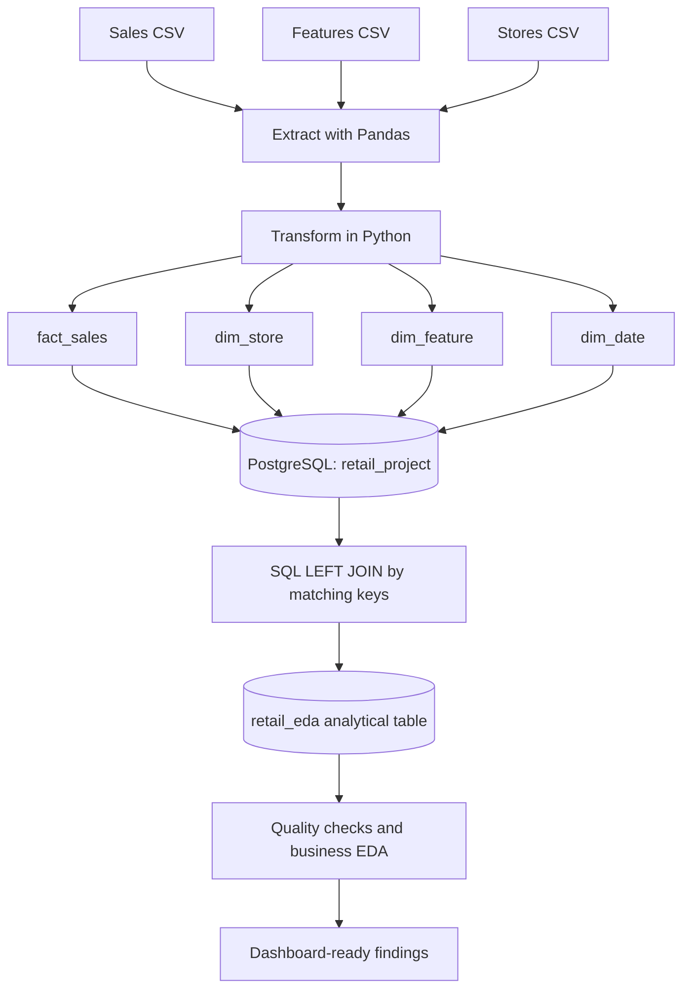

# Retail Sales ETL & Business Insights

**Turning three raw retail datasets into a structured PostgreSQL model—and using that model to understand sales performance, seasonal demand, and economic context.**

`Python` · `Pandas` · `SQLAlchemy` · `PostgreSQL` · `SQL` · `Exploratory Data Analysis`

## Project overview

Retail sales numbers rarely explain themselves. A higher total might reflect a larger store, a stronger department, a holiday week, or simply more observations. Economic indicators can add context, but they are recorded at a different level of detail from individual department sales. Comparing these measures without preparing the data first risks drawing the wrong conclusions.

I built this project to approach that problem from two directions. **On the data engineering side**, I use Python to extract three CSV files, transform them into four related tables, and load the results into PostgreSQL. **On the analytical side**, I join those tables into a dedicated `retail_eda` table and use SQL to investigate store performance, department contributions, holidays, and economic conditions.

The central idea is simple: **organize the data according to what each record represents before asking business questions of it**. The pipeline is as important as the final numbers, because trustworthy comparisons depend on trustworthy data preparation.

## The business questions

The analysis is guided by four practical questions:

1. **Where do sales come from?** Which stores and departments contribute most to the total, and how does performance vary by store type?
2. **How does performance change over time?** Are there visible seasonal patterns, and how should partial years be compared?
3. **What happens during holiday weeks?** Is average sales performance different from non-holiday weeks, after accounting for unequal numbers of observations?
4. **What role might external conditions play?** How can temperature, fuel prices, the Consumer Price Index (CPI), and unemployment provide context without being mistaken for proven causes?

This is an exploratory project, not a forecasting or causal-inference model. Its purpose is to uncover patterns, validate assumptions, and identify questions worth investigating further.

## Data: what I started with

The project begins with **three original CSV files**, each describing a different part of the retail operation.

| Original file | Rows | Grain / what one row represents | Core fields |
| --- | ---: | --- | --- |
| `Data/sales_dataset.csv` | **421,570** | One store–department–week sales observation | `Store`, `Dept`, `Date`, `Weekly_Sales`, `IsHoliday` |
| `Data/Features_dataset.csv` | **8,190** | One store–date observation of external conditions | `Store`, `Date`, `Temperature`, `Fuel_Price`, `CPI`, `Unemployment`, `IsHoliday`, `MarkDown1`–`MarkDown5` |
| `Data/stores_dataset.csv` | **45** | One store | `Store`, `Type`, `Size` |

The original sales data covers **45 stores, 81 departments, and 143 distinct weekly dates from 5 February 2010 to 26 October 2012**. The features file extends beyond that sales period, so the full features file should not be treated as a list of sales weeks.

These inputs were kept separate at extraction because they have **different meanings and different levels of detail**. Store type and size describe a store, economic variables describe conditions for a store on a date, and sales describe an individual department's activity within that store and week.

## How the pipeline works



### 1. Extract — bring in the original data

`ETL/extract.py` loads the three files with Pandas, previews their first rows and data types, and passes the DataFrames into the next stage. At this point, no JOIN is performed. Keeping extraction separate makes it easier to recognize issues in the source files before changing their structure.

### 2. Transform — reorganize three inputs into four tables

`ETL/transform.py` creates **four output DataFrames from the three source datasets**. This is a deliberate modeling choice: the transformed data separates measurable sales activity from the attributes used to describe and compare it.

| Transformed table | Built from | Intended analytical role | Rows from the supplied raw data |
| --- | --- | --- | ---: |
| `fact_sales` | Sales CSV | The main sales records, at store–department–week grain | **421,570** |
| `dim_store` | Stores CSV | Store type and size, associated with each store | **45** |
| `dim_feature` | Features CSV | Temperature and economic context by store and date | **8,190** |
| `dim_date` | Unique `Date`–`IsHoliday` pairs from sales | Calendar fields for time-based comparisons | **143** |

The transformation script performs the following operations:

- Parses the sales dates using `DD/MM/YYYY` and features dates using `YYYY-MM-DD`, preventing mismatches when the two datasets are joined.
- Removes the five `MarkDown` columns from the features data. This narrows the current analysis to the selected economic and environmental indicators; it also means promotional markdown effects are **outside this project's present scope**.
- Applies `drop_duplicates()` when preparing the dimension DataFrames, and derives `year`, `month`, and ISO `week` for `dim_date`.
- Normalizes column names to lowercase with underscores for consistent SQL references.
- Retains the original sales values, including negative and zero amounts, rather than silently altering observations that may have a business explanation.

**Why not just combine everything in Python immediately?** Separating the tables makes the data's grain and relationships visible. The same store attributes apply to many department records, and the same economic reading applies to multiple departments in one store-week. The resulting design is *star-schema-inspired*; it is not presented as a fully constrained dimensional warehouse, because primary/foreign-key constraints are not created by the current scripts.

### 3. Load — store the model in PostgreSQL

`ETL/load.py` writes `dim_store`, `dim_date`, `dim_feature`, and `fact_sales` into the `public` schema of the **`retail_project`** PostgreSQL database with SQLAlchemy. `main.py` coordinates the Extract → Transform → Load sequence.

The database connection reads its settings from a local `.env` file. This keeps credentials out of the Python source and GitHub repository.

**Implementation detail:** The current loader uses `if_exists='replace'`. That is convenient for rebuilding a development database, but every ETL run replaces the four tables. It is not an incremental-load strategy, and it can affect dependent database objects. Run it intentionally and on a development database.

### 4. SQL JOIN — build `retail_eda` for analysis

After the four tables exist in PostgreSQL, `retail.sql` creates **a separate physical table** named `retail_eda` using `CREATE TABLE ... AS SELECT`. This JOIN takes place **in PostgreSQL, after the Python transformation and load**, not inside `transform.py`.

| Join | Matching rule | Reason |
| --- | --- | --- |
| `fact_sales` → `dim_store` | `store = store` | Assigns store type and size to sales records |
| `fact_sales` → `dim_feature` | Match **both `store` and `date`** | Connects economic conditions to the correct store **and week** |
| `fact_sales` → `dim_date` | `date = date` | Adds year, month, and week attributes |

Using **`LEFT JOIN` from `fact_sales`** is intentional: sales observations should remain in the analysis even if a dimension has no matching record. Matching features on *store and date* is especially important; matching only on store could multiply sales rows across many weeks and inflate totals.

`retail_eda` makes common analytical questions easier to answer without rewriting the four-table JOIN every time. Because it is a **physical table rather than a view**, changes to the underlying ETL tables do **not** automatically update it. The table has to be rebuilt or refreshed separately.

## Data validation: why the 45-store source and 18-store export differ

During validation, I found an important **coverage mismatch** between the original data and a CSV exported from `retail_eda`.

| Measure | Original sales CSV | Supplied `retail_eda` CSV export |
| --- | ---: | ---: |
| Rows | **421,570** | **170,640** |
| Distinct stores | **45** | **18** |
| Distinct departments | **81** | **80** |
| Distinct sales dates | **143** | **143** |
| Coverage of original sales rows | 100% | **40.48%** |

The difference is **not** explained by the business meaning of the JOIN. In the supplied raw files, store identifiers and feature store–date keys are unique where expected; every original sales row has a matching store and store–date feature record. The intended `LEFT JOIN` should therefore be capable of retaining **all 421,570 sales rows**, assuming the database contains the complete transformed inputs.

A row-by-row comparison also confirms that **all 170,640 exported sales records are present in the original sales CSV**. However, coverage is uneven:

- **Store 2–17:** All original sales rows are present in the export.
- **Store 1:** **9,204 of 10,244** rows are present; the missing **1,040** are concentrated at the beginning of the date range.
- **Store 18:** **4,352 of 9,859** rows are present; the missing **5,507** are concentrated in the later dates.
- **Store 19–45:** No records appear in the supplied export.

**What this means:** the supplied CSV is an **incomplete analytical snapshot**, not evidence that the original business operated only 18 stores. The exact reason cannot be established from CSV files alone. It may reflect a partial export, a filtered result, or incomplete data in the PostgreSQL tables at the time of export. The decisive check is to compare row counts **inside PostgreSQL** before exporting again.

Run these queries in pgAdmin:

```sql
-- How much of the original sales data is actually in PostgreSQL?
SELECT COUNT(*) AS rows, COUNT(DISTINCT store) AS stores
FROM public.fact_sales;

-- How much of the joined analytical table is in PostgreSQL?
SELECT COUNT(*) AS rows, COUNT(DISTINCT store) AS stores
FROM public.retail_eda;

-- Which stores are represented in the analytical table?
SELECT store, COUNT(*) AS sales_records
FROM public.retail_eda
GROUP BY store
ORDER BY store;
```

**Interpret the results:**

- If `fact_sales` and `retail_eda` both show **421,570 rows / 45 stores**, then the exported CSV is incomplete: re-export the full table, not a partial result grid or selected subset.
- If `fact_sales` has **421,570 rows / 45 stores**, but `retail_eda` has fewer, inspect the SQL used to create `retail_eda`, any filters, and whether it was built from an earlier database state.
- If `fact_sales` itself has fewer rows or stores, investigate the source loaded into PostgreSQL and whether the ETL pipeline completed successfully.

This check is part of the analytical work: before trusting a headline number or publishing a dashboard, **reconcile the analysis table against the source at the correct level of detail**.

## Exploratory data analysis and business findings

The findings below are calculated from the **complete supplied raw sales CSV (45 stores)** unless explicitly stated otherwise. They describe observed patterns, not causal effects. Sales amounts are expressed in **source-data units** because a currency is not specified in the files.

### Sales concentration and store performance

Across the original 421,570 records, total recorded sales are approximately **6.74 billion**. Mean sales per store–department–week observation are **15,981.26**, compared with a median of **7,612.03**. The large gap shows why the median is useful alongside the mean: relatively high sales records can pull the average upward.

**Store 20** has the largest cumulative sales in the full dataset (approximately **301.40 million**), followed closely by **Store 4** (approximately **299.54 million**). At department level, **Department 92** contributes the highest total (approximately **483.94 million**). These rankings help identify where a retailer could begin a closer performance review, but totals alone do not measure efficiency or profitability.

By store type, the share of total recorded sales is approximately **64.3% Type A**, **29.7% Type B**, and **6.0% Type C**. These are contributions, not like-for-like productivity comparisons: the dataset includes **22 Type A, 17 Type B, and 6 Type C stores**, with different sizes and department mixes. A fairer comparison would also evaluate sales per store, per department, or relative to store size.

### Holiday and non-holiday demand

Average sales per observation are about **17,035.82** in holiday weeks versus **15,901.45** in non-holiday weeks—approximately **7.1% higher** during holiday observations in the original sales dataset.

This comparison uses averages rather than simply comparing total sales because there are **10 distinct holiday dates** and **133 non-holiday dates**. It suggests that holiday periods deserve attention in planning, but it does **not** show that the holiday flag itself caused higher sales. Product mix, specific holidays, store composition, and timing can also influence the result.

### Store characteristics and economic context

Store size is worth investigating alongside sales, but a larger total can reflect greater capacity rather than stronger performance per unit of space. Similarly, temperature, fuel prices, CPI, and unemployment may move with demand without independently explaining it.

A separate exploratory check aligned the original sales data and economic observations at **one row per store and date (6,435 store-weeks)**. The resulting simple linear correlations between store-week sales and individual indicators were relatively weak: approximately **−0.064** for temperature, **+0.009** for fuel price, **−0.073** for CPI, and **−0.106** for unemployment. These are descriptive checks, not the output of a multivariable or causal model.

This **grain alignment** matters. The same temperature or CPI observation is repeated across departments after the JOIN. Calculating relationships directly on those repeated rows can give undue weight to store-weeks with more department records. For economic comparisons, sales should first be aggregated to store–date level and matched to a single corresponding economic observation.

### Data quality and interpretation

The original sales file includes **1,285 negative sales values** and **73 zero-sales values**. They are not automatically removed. Negative figures might indicate returns or adjustments, but the files do not contain a transaction-level explanation to verify that. Automatically deleting them would change the totals and could conceal a relevant operational pattern.

The supplied 18-store export contains **469 negative** and **33 zero** sales records, with **no missing values in its 14 analytical columns** and no duplicate store–department–date keys. These clean-looking export statistics do not resolve its coverage gap: **a dataset can have no nulls and still be incomplete**.

Finally, **2010 and 2012 are partial calendar years** in the sales data. Their annual sales totals should not be compared directly with the full year 2011 as though all three years had equal observation windows.

## What the SQL analysis covers

The `retail.sql` file documents the analytical steps performed in PostgreSQL:

- **Integrity checks:** missing fields, duplicate store–department–date combinations, and negative/zero sales.
- **Sales analysis:** yearly totals, top-selling stores and departments, and store-type comparisons.
- **Holiday analysis:** holiday versus non-holiday average sales and year-based comparisons.
- **Economic analysis:** annual average temperature, fuel prices, CPI, and unemployment alongside yearly sales.

For the economic annual averages, the SQL deduplicates observations by store and date before calculating means, avoiding repeated economic readings for each department. The store-week correlations mentioned above are an additional validation performed on the supplied data, **not a query currently contained in `retail.sql`**.

## Reproducing the project

**Requirements:** Python, PostgreSQL, and the three original CSV files in the `Data/` directory.

1. Clone the repository and open the project folder.
2. Install dependencies:

   ```bash
   python -m pip install pandas sqlalchemy psycopg python-dotenv
   ```

3. Create a local `.env` file in the project root (do **not** commit it):

   ```dotenv
   DB_HOST=localhost
   DB_PORT=5432
   DB_NAME=retail_project
   DB_USER=postgres
   DB_PASSWORD=your_local_password
   ```

4. Create the `retail_project` database in PostgreSQL if necessary, then run:

   ```bash
   python main.py
   ```

5. Open `retail.sql` in pgAdmin. Run the analytical-table `CREATE TABLE retail_eda AS ...` statement, then the EDA queries. **Before running the entire script**, change any `#` section markers into valid PostgreSQL `--` comments. If `retail_eda` already exists, decide whether to drop/rebuild it before rerunning `CREATE TABLE`.
6. Validate that `fact_sales` and `retail_eda` have the expected **421,570 records across 45 stores**, assuming all supplied raw sales data was loaded and no deliberate filters were introduced.
7. Export the **entire** `retail_eda` table for Excel or BI analysis; check the exported row and store counts again before using it in a dashboard.

**Security note:** `.env` belongs in `.gitignore`. Do not commit database passwords or connection strings with embedded credentials.

## Repository structure

```text
Retail_Project/
├── Data/
│   ├── Features_dataset.csv
│   ├── sales_dataset.csv
│   └── stores_dataset.csv
├── ETL/
│   ├── extract.py
│   ├── transform.py
│   └── load.py
├── main.py
├── retail.sql
├── .gitignore
└── README.md
```

## Limitations and next steps

This repository documents an **ETL pipeline and SQL-based exploratory analysis**. It does not yet claim a completed, validated Power BI or Excel dashboard. A logical next step is a three-page report covering **Sales Overview**, **Store & Department Performance**, and **Holiday & Economic Insights**—built only after reconciling the full `retail_eda` export with PostgreSQL.

The work can be extended by adding automated reconciliation tests, database constraints and indexes, a repeatable refresh process for the physical analytical table, improved handling of returned/negative sales, and comparisons that control for store size and seasonality. The current dataset also cannot establish the causal effects of holidays or economic conditions on sales.

---

## Power BI Dashboard — Retail Sales Analytics

The Power BI dashboard transforms the processed `retail_eda` dataset into an interactive business intelligence report, providing insights into **sales performance, store contributions, seasonal demand, and economic conditions**.

The dashboard consists of three analytical pages:

| Dashboard Page | Main Focus |
|---|---|
| **Sales Overview** | Overall sales, monthly trends, and revenue distribution |
| **Store & Department Performance** | Store rankings, department contributions, and store characteristics |
| **Economic & Holiday Insights** | Economic indicators, holiday demand, and sales relationships |

### 1. Sales Overview

Provides a high-level view of retail performance across **45 stores and 81 departments** from February 2010 to October 2012.

**Key Metrics**

| Metric | Value |
|---|---:|
| Total Sales | **6.74bn** |
| Average Weekly Sales | **15.98K** |
| Total Stores | **45** |
| Total Departments | **81** |

**Business Insights**
- **Store 20** generates the highest cumulative sales, approximately **301.4M**.
- **Store Type A** contributes **64.28%** of total sales, followed by Type B (29.7%) and Type C (6.02%).
- Monthly sales fluctuate considerably, indicating variations in retail demand across the reporting period.
- Sales contributions are uneven across stores and store types, highlighting the importance of segment-level performance analysis.

### 2. Store & Department Performance

Examines how individual stores, departments, and store characteristics contribute to overall sales.

**Key Metrics**

| Metric | Value |
|---|---:|
| Active Stores | **45** |
| Average Store Sales | **149.72M** |
| Highest Performing Store | **Store 20** |
| Total Departments | **81** |

**Business Insights**
- **Store 20 (301.4M)** and **Store 4 (299.5M)** lead cumulative sales performance.
- Store Type A generates approximately **4.33bn**, compared with **2.00bn** for Type B and **0.41bn** for Type C.
- **Department 92** records the highest sales contribution, approximately **483.9M**.
- Larger stores often generate higher cumulative sales, but store size alone does not explain differences in performance.
- Comparing stores by sales contribution and physical size helps identify opportunities for further operational analysis.

### 3. Economic & Holiday Insights

Explores the relationship between retail activity, economic indicators, and seasonal purchasing patterns.

**Key Metrics**

| Metric | Value |
|---|---:|
| Average CPI | **171.58** |
| Average Fuel Price | **3.36** |
| Average Unemployment | **8.00%** |
| Holiday Sales Difference | **+7.8%** |

**Economic Correlation Analysis**

| Indicator | Pearson Correlation | Interpretation |
|---|---:|---|
| Temperature | -0.064 | Very weak negative |
| Fuel Price | +0.009 | Almost no linear relationship |
| CPI | -0.073 | Very weak negative |
| Unemployment | -0.10 | Weak negative |

**Business Insights**
- Average store-week sales during holidays are approximately **7.8% higher** than during non-holiday periods.
- Monthly sales patterns suggest seasonal demand variations, particularly toward the end of the year.
- Economic indicators show **weak individual linear correlations** with sales, suggesting that retail performance involves multiple contributing factors.
- Holiday trends can help inform inventory and operational planning, although the observed relationships do not establish causation.

### Key Business Takeaways

| Area | Main Finding | Business Implication |
|---|---|---|
| **Sales Performance** | Total sales reach approximately 6.74bn | Establishes an overall performance baseline |
| **Store Performance** | Store 20 leads cumulative sales | Identifies high-contributing stores for further analysis |
| **Store Types** | Type A contributes 64.28% of sales | Highlights concentration of revenue across store categories |
| **Department Performance** | Department 92 contributes approximately 483.9M | Identifies a major departmental sales contributor |
| **Holiday Demand** | Holiday store-week sales are 7.8% higher | Supports further investigation into seasonal demand planning |
| **Economic Factors** | Correlations with sales are relatively weak | Encourages analysis beyond individual economic indicators |

**Note:** These findings are descriptive and based on the available reporting data. Sales amounts use the dataset's original units. Correlation does not imply causation, and cumulative sales do not necessarily represent store efficiency or profitability.
